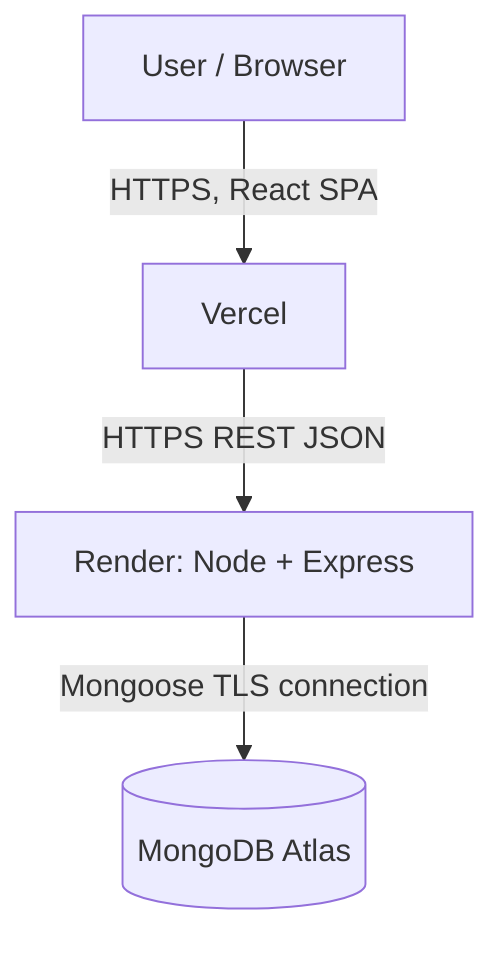

# Helpdesk DFA — deployment starter

## Analysis and architecture

This request describes a full academic MERN application; the supplied workspace had no application source to extend. This folder is a deployment foundation, not a completed ticket lifecycle system. It supplies a small React/Vite frontend, SPA rewrite, API connectivity screen, Express startup, Atlas connection, health endpoint, and deployment guide. Authentication, ticket CRUD, role authorization, schemas, DFA transitions/audit logs, charts, and academic pages remain to be implemented before this can be called the requested full system.

### Subject integration

- **Full stack web development:** React/Vite sends JSON REST requests to an Express API. MongoDB/Mongoose is the persistence layer. Authentication and authorization belong on the backend.
- **Computer networks:** Browser-to-Vercel and browser-to-Render use HTTPS; the browser uses HTTP REST semantics over TLS/TCP/IP and DNS resolves service hostnames. The OS networking stack implements TCP/IP; this project does not implement those protocols itself.
- **FLAT:** The backend must own the DFA state transition function and reject undefined transitions. The client may display the definition or simulation results but cannot authorize lifecycle changes.

### Architecture

### DFA definition to implement

`M = (Q, Σ, δ, q0, F)` where `Q={OPEN, ASSIGNED, IN_PROGRESS, RESOLVED, CLOSED, CANCELLED}`, `Σ={ASSIGN, START, REASSIGN, RESOLVE, REOPEN, CLOSE, CANCEL, UNASSIGN}`, `q0=OPEN`, and `F={CLOSED,CANCELLED}`. Defined transitions: OPEN/ASSIGN→ASSIGNED; OPEN/CANCEL→CANCELLED; ASSIGNED/START→IN_PROGRESS; ASSIGNED/UNASSIGN→OPEN; ASSIGNED/REASSIGN→ASSIGNED; IN_PROGRESS/REASSIGN→ASSIGNED; IN_PROGRESS/RESOLVE→RESOLVED; RESOLVED/REOPEN→IN_PROGRESS; RESOLVED/CLOSE→CLOSED. Every omitted pair must reject. A separate explicit product decision is needed for whether CANCELLED is considered accepting (the brief says both cancelled and closed are final). Persist each successful transition atomically with the ticket update; separately record rejected attempts.

### Database plan

Use `User`, `Ticket`, `TicketHistory`, `AuditLog`, and `Comment` Mongoose models with ObjectId references. Add unique indexes for normalized user email and ticketId; indexes for `(createdBy, createdAt)`, `(assignedTo, currentState)`, and `(ticketId, timestamp)` on history/comments/audit. Set schema validation and timestamps. These models and indexes are planned, not yet implemented in this starter.

## Run locally

1. Install Node.js LTS and MongoDB locally or create an Atlas cluster.
2. In `backend`, run `npm install`, copy `.env.example` to `.env`, set `MONGODB_URI` and a long random `JWT_SECRET`, then run `npm run dev`.
3. In `frontend`, run `npm install`, copy `.env.example` to `.env`, set `VITE_API_URL=http://localhost:5000/api`, then run `npm run dev`.
4. Open Vite’s printed local URL; `/health` displays API connectivity.

Never commit `.env`. The supplied examples contain placeholders only.

## Cloud deployment

Read [deployment-guide.md](documentation/deployment-guide.md). No services have been deployed, and no live URLs are known. Replace the placeholders in this README only after deployment and smoke testing.

- Live frontend: **Not deployed — URL pending**
- Backend API: **Not deployed — URL pending**
- Database: MongoDB Atlas planned; credentials must stay in Render environment settings.
