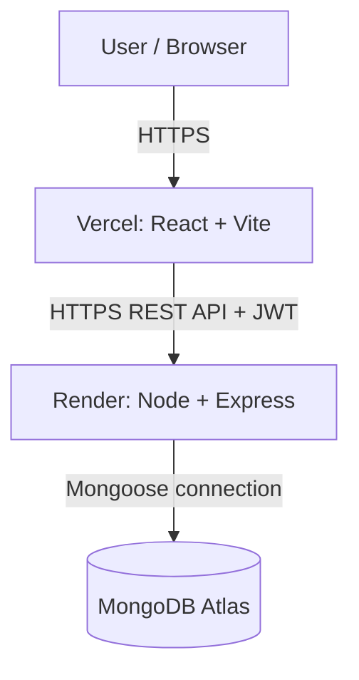

# Deployment guide

This project supports local development and separate cloud hosting: React/Vite on Vercel, Node/Express on Render, and MongoDB on Atlas. No cloud URLs are filled in until services have actually been deployed and verified.

## Architecture



The backend owns authentication, role and ticket access checks, database operations, DFA transitions, history, and audit logs. The browser receives only the public backend API URL.

## 1. Create a MongoDB Atlas cluster

1. Sign in to MongoDB Atlas, create a project, and create a cluster in a region geographically close to the Render service.
2. In **Database Access**, add a database user for this application. Use a unique strong password and the minimum database permissions needed for the project. This database user is separate from your Atlas website login.
3. In **Network Access**, allow the Render service’s outbound IPs if your Render plan provides stable ranges. Otherwise Atlas may require `0.0.0.0/0`; pair this with a strong unique database password and least-privilege database user.
4. From the cluster, select **Connect → Drivers** and copy the `mongodb+srv://` URI. Replace the username, password, and database-name placeholders. URL-encode special characters in the username/password.
5. Store the URI only in backend environment variables. Do not put it in Vite variables, source code, README text, or committed files.

The Mongoose models create the `users`, `tickets`, `tickethistories`, `auditlogs`, and `comments` collections as documents are first written. Mongoose schemas define validation and indexes; confirm indexes have finished building in Atlas before relying on them in a newly created database.

## 2. Connect MongoDB Atlas to Render

1. In Render, open the backend Web Service and go to **Environment**.
2. Add `MONGODB_URI` with the full Atlas connection string. Mark it secret if Render offers that option.
3. Add `JWT_SECRET` with a long random secret generated for production. Never reuse a password or commit the value.
4. Ensure Atlas Network Access permits Render’s outbound traffic and the database user has access to the selected database.
5. Save changes and redeploy. The app connects with Mongoose before opening its HTTP listener. A failed startup is logged and exits with a non-zero status; `/api/health` reports database readiness after startup.

## 3. Deploy the backend on Render

Create a **Web Service** from the `HELPDESK-DFA` GitHub repository:

- Runtime: **Node**
- Root directory: `backend`
- Build command: `npm install`
- Start command: `npm start`
- Health check path: `/api/health`

Set environment variables:

| Key | Value |
|---|---|
| `MONGODB_URI` | Atlas driver URI; secret |
| `JWT_SECRET` | Long random production secret; secret |
| `CLIENT_URL` | Exact Vercel production origin, such as `https://<your-project>.vercel.app` |
| `NODE_ENV` | `production` |
| `PORT` | Let Render provide this value automatically |

The app listens on `process.env.PORT` and binds to `0.0.0.0`. After deployment, copy the actual HTTPS host assigned by Render. The API health URL is `<actual-render-origin>/api/health`. Do not use an example hostname as a real deployment URL.

## 4. Configure CORS

Set `CLIENT_URL` to the exact Vercel origin including `https://` and without a trailing slash. For multiple origins, separate exact origins with commas. Save the Render environment and redeploy. CORS only controls browser-origin access; it does not replace JWT authentication or API authorization.

## 5. Deploy the frontend on Vercel

Import the repository into Vercel and configure:

- Root directory: `frontend`
- Framework preset: **Vite**
- Build command: `npm run build`
- Output directory: `dist`
- Environment variable `VITE_API_URL`: the actual Render API base URL ending in `/api`, for example `https://<actual-render-host>/api`

The included `frontend/vercel.json` rewrites application routes to `index.html`, allowing React Router pages to load after a refresh. Set `VITE_API_URL` for **Production** (and Preview if desired), then redeploy. Vite embeds `VITE_*` values in browser code, so this value must contain only the public API origin, never a secret.

## 6. Environment variable reference

Backend local file `backend/.env` (never commit):

```dotenv
MONGODB_URI=mongodb+srv://<db-user>:<url-encoded-password>@<cluster-host>/<database>?retryWrites=true&w=majority
JWT_SECRET=<long-random-secret>
CLIENT_URL=http://localhost:5173
NODE_ENV=development
PORT=5000
```

Frontend local file `frontend/.env` (never commit):

```dotenv
VITE_API_URL=http://localhost:5000/api
```

Local setup: copy each `.env.example` to `.env`, fill in values, and restart the dev server after changing environment variables. In production enter backend values in Render and `VITE_API_URL` in Vercel, not in a committed file.

## 7. Test deployed REST APIs

Replace `<actual-render-origin>` with the URL shown in the Render dashboard:

1. `GET <actual-render-origin>/api/health` should return HTTP 200 with `status: "ok"` and `database: "connected"`.
2. `GET <actual-render-origin>/` should return the service name and health path.
3. Register with `POST /api/auth/register` using JSON `{ "name": "Example User", "email": "user@example.com", "password": "a-strong-password" }`; expect HTTP 201 and a bearer token.
4. Use `POST /api/auth/login` with those credentials; expect HTTP 200. Send the returned token as `Authorization: Bearer <token>`.
5. As a requester, `POST /api/tickets` with `{ "title": "Cannot access application", "description": "The application displays an error when I sign in.", "category": "Software", "priority": "Medium" }`.
6. As an administrator, use `POST /api/auth/login` for a provisioned production admin account, then assign the ticket through `PATCH /api/tickets/:id/assign` with `{ "agentId": "<active-agent-object-id>" }`.
7. Test valid lifecycle actions through `PATCH /api/tickets/:id/transition` with `{ "action": "START" }` (as the assigned agent), then `{ "action": "RESOLVE" }`, then `{ "action": "CLOSE" }` (admin). Test an undefined transition and expect HTTP 409.
8. Check `GET /api/tickets/:id` for history/comments, `GET /api/dashboard/stats` for MongoDB-backed statistics, and the Atlas collections for persisted documents.

Do not use the development demo accounts on a public production database. Provision the production administrator and agent through a controlled procedure before doing these role-specific checks. Do not put bearer tokens or real passwords in shell history, screenshots, or issue reports.

## 8. Verify cloud connectivity

- Render dashboard logs should show `MongoDB connected` and `API listening on ...` after startup.
- `/api/health` must show both API status and database status as `connected`/`ok`.
- Open the Vercel site, sign in, and use browser Developer Tools → Network to verify API requests target the actual Render HTTPS origin and return expected responses.
- Verify created users, tickets, transitions, comments, and history in Atlas; dashboard counts should reflect persisted tickets.
- Confirm direct refresh on `/tickets`, `/dfa`, and other SPA routes succeeds.

## 9. Troubleshooting

- **`MONGODB_URI is required`:** Add the exact key `MONGODB_URI` to Render’s environment, save, and redeploy. Check for whitespace or a typo in the key.
- **`bad auth: authentication failed`:** Confirm the Atlas database username/password (not the Atlas account login), URL-encode special characters, reset the DB user password if needed, update Render’s secret, and redeploy.
- **Atlas connection timeout:** Check cluster state, Atlas Network Access, database privileges, URI host, and outbound connectivity.
- **Render exits during startup:** Review the first application error in Render logs, confirm `npm install` and `npm start`, required environment variables, and whether Atlas is reachable.
- **CORS blocked:** The browser Origin must exactly match one of the comma-separated origins in `CLIENT_URL`; save and redeploy Render.
- **Frontend calls localhost in production:** Set Vercel `VITE_API_URL` to the actual Render API base URL and redeploy the frontend.
- **Vercel build fails:** Use `frontend` as root, `npm run build` as command, and `dist` as output; check the build log for JSX or dependency errors.
- **Refresh on an app route returns 404:** Confirm Vercel is deploying `frontend/vercel.json` and redeploy.
- **401 or 403:** Check that the token is present and current, and the signed-in role owns or is assigned the requested ticket/action.
- **Ticket assignment or lifecycle request returns 409:** This means the requested DFA edge is undefined from the current state; inspect ticket history and the DFA monitor for legal actions.
- **A password or URI was exposed:** Rotate the Atlas database password and any shared JWT secret, update Render’s environment, redeploy, and ensure the old values are not in Git history.
